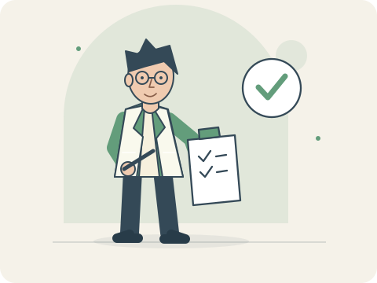

# Research Persona Atlas

**Is the researcher you are today the same person you hope to become?**

Some people ask for the evidence. Some automate the repetitive work. Others question the question itself. Explore 16 illustrated research personas and find the habits that feel familiar.

## [Try the assessment →](https://dzrstark.github.io/research-persona-atlas/)

Free, no account required, and works on mobile. The assessment and character stories are currently in Chinese.

## What makes it fun?

- **Two portraits of you.** Answer 36 questions about your recent habits and your preferred future direction, then compare your actual and aspirational personas.
- **Characters with stories.** Each persona has an original cartoon, an inner monologue, research-life scenes, and five chapters about thinking, daily work, collaboration, pitfalls, and next steps.
- **A whole cast to explore.** Browse the [16-persona handbook](https://dzrstark.github.io/research-persona-atlas/portraits.html) without taking the assessment, or explore connections in the interactive atlas.
- **A portrait to share.** Export both characters and their stories as a PNG. Choose the full reading or a shorter version for friends.

## Getting started

Open the site and allow around eight minutes. Answer each question twice, choose three priorities, and explore your results. Progress is saved in the same browser when local storage is available.

Answers are calculated and stored in your browser, not uploaded. Exported images exclude raw answers and optional background information. Records do not automatically sync across devices.

This is a research-style reflection tool, not a validated psychological assessment or a measure of ability. No persona is better than another, and an aspirational portrait describes a preference rather than an existing skill.

[中文](README.md) · [Feedback](https://github.com/DzrStark/research-persona-atlas/issues) · [Contributing](CONTRIBUTING.md) · [MIT license](LICENSE)
