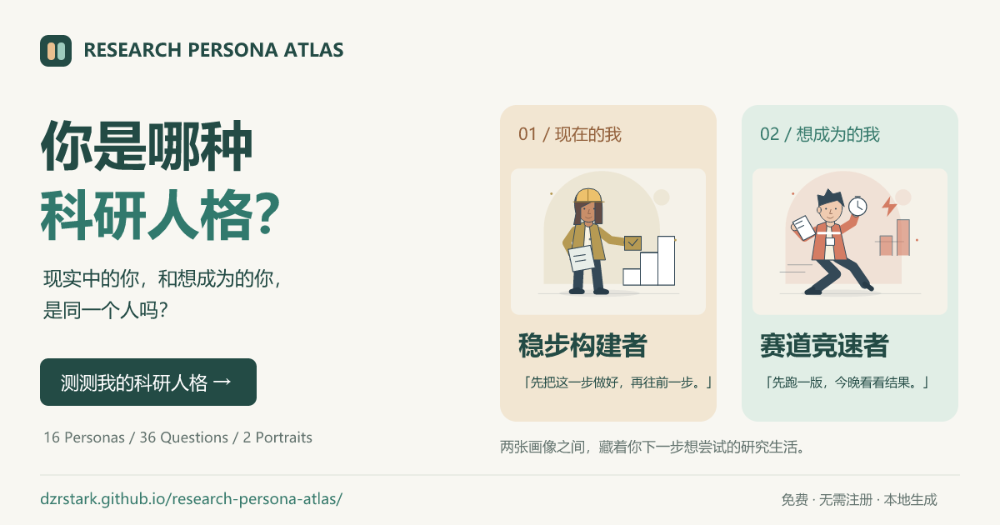
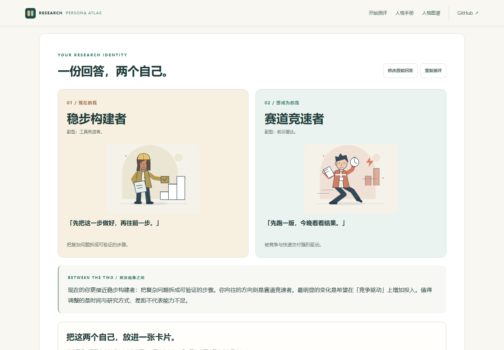
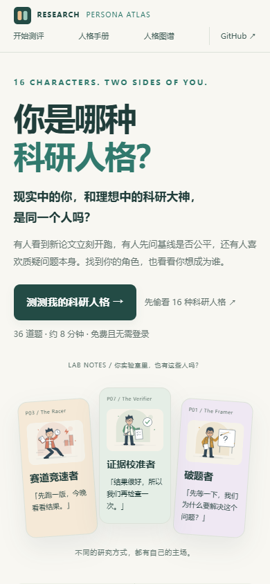
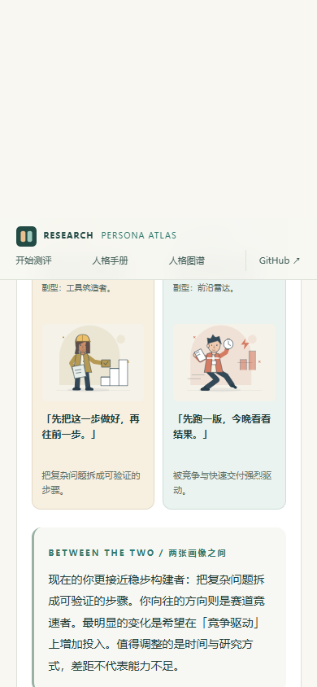
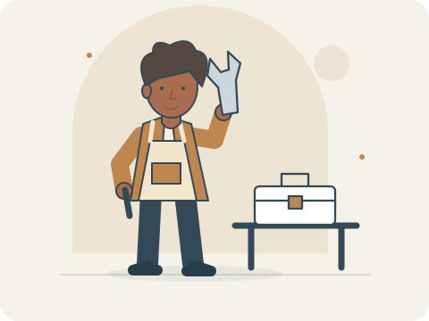
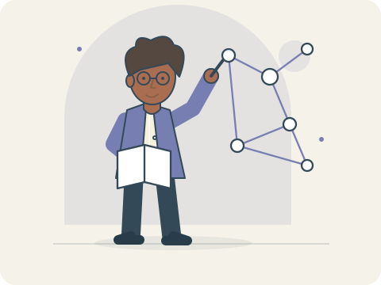
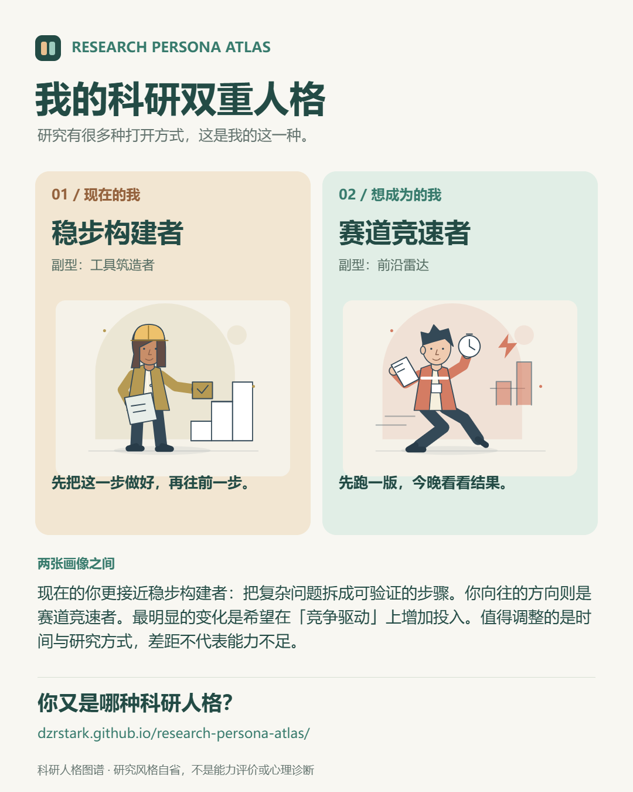

# 科研人格图谱

**组会上的你，和想象中科研开挂的你，是同一种人格吗？**

有的人看到结论，第一反应是「证据呢？」；有的人看到重复劳动，已经开始写工具；还有人听完一个问题，先问「我们为什么要这样问？」

这里有 16 种研究角色。用 36 道题，看看你现在更像谁，又想成为谁。

### [开始测评 →](https://dzrstark.github.io/research-persona-atlas/)

[先逛逛 16 型人格手册](https://dzrstark.github.io/research-persona-atlas/portraits.html) · 免费 · 无需注册 · 手机也能打开

## 一份回答，两个自己

先看懂自己的两种研究状态，再决定要不要展开完整故事。暖色是现在的习惯，冷色是想靠近的方向，没有高低之分。

看看手机上的样子

 

## 你的科研日常，可能藏在这些角色里

| 证据校准者 | 工具筑造者 | 理论抽象者 |
| :---: | :---: | :---: |
|  |  |  |
| 「先别庆祝，误差条呢？」 | 「这件事为什么还需要手动做？」 | 「这些现象背后，会不会是同一件事？」 |

*上面的台词是角色小剧场。你也可能同时带着几个角色的影子。*

## 不止一个名字，还有一段让你对号入座的故事

每种人格都有专属人物插画、内心台词和科研小剧场。长篇解读会聊到你怎么想问题、怎么过科研日常、怎样与别人合作，以及那些「很擅长，但也容易把自己绕进去」的地方。

你可以边读边点头，也可以笑着反驳：「这段像我，但那段绝对是我同门。」

## 同时看看「现在的我」和「想成为的我」

每道题回答两次：一次回想过去六个月的真实行为，一次选择未来六个月希望投入的方向。最后会得到两张人物画像。

也许你现在擅长把证据查得滴水不漏，却向往去探索没人走过的路。两张画像的差别，可以成为下一步尝试的线索。页面还会用 12 维对照和行动建议，帮你把「想改变」变得具体一点。

## 看完自己的，也能逛逛别人的

16 种角色都能在[人格手册](https://dzrstark.github.io/research-persona-atlas/portraits.html)里直接阅读，无需先做测评。也可以在互动图谱里点选角色，看看不同研究风格之间的联系，以及你感兴趣的发展方向。

破题者、前沿雷达、赛道竞速者、深钻者、风险探路者、稳步构建者、证据校准者、工具筑造者、系统整合者、独立航行者、协作织网者、长线耕作者、应用转译者、趋势借力者、范式质疑者、理论抽象者——哪个名字已经让你想到了某个人？

## 把你的角色带走

完成测评后，默认生成一张 **4:5 科研双画像社交卡**：人物插画、台词、主副型和两种状态之间的差异，放进一张可以直接发给同门的图片。

- 想发给朋友：选择默认的「社交卡」。
- 想收藏细读：切换到「完整报告长图」，保留介绍与五章解读。
- 手机浏览器支持时，还可以直接调用系统分享。

图片不会包含你的原始回答或可选背景信息。

## 怎么玩？

1. [打开网页](https://dzrstark.github.io/research-persona-atlas/)，点击「开始测评」。
2. 回答 36 道题，并选出你最想优先投入的三个方向。预计约 8 分钟，可以慢慢想。
3. 阅读双画像、探索图谱，再生成自己的分享卡。

答到一半离开，通常可以在同一浏览器继续；需要重新开始时，可以清空本地记录。

## 关于你的数据与结果

作答在浏览器中计算和保存，不上传测评答案，无需提供姓名或注册账号。换设备、换浏览器或清除浏览器数据后，记录不会自动同步。

这是一个有趣的研究风格自省工具，尚未经过心理测量验证。角色没有高低之分，结果不代表科研能力，也不能预测学术成就。理想画像表达的是你希望靠近的方向。

---

喜欢这个科研人格宇宙？欢迎在 GitHub 给项目一颗 Star，也欢迎把链接发给会对号入座的朋友。

[反馈问题或分享建议](https://github.com/DzrStark/research-persona-atlas/issues) · [English](README.en.md) · [本地运行与贡献指南](CONTRIBUTING.md) · [MIT 许可](LICENSE)
