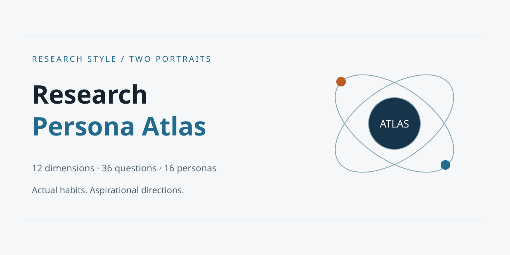

# Research Persona Atlas · 科研人格图谱

面向科研人员的双画像研究风格测评：用过去六个月的实际行为和未来六个月的理想投入，探索 12 个维度、16 种原型与可行动的发展路径。

当前为开发中的 V1。算法测试已建立；完整浏览器验收和产品截图尚未完成。没有公开部署地址，不能把本地演示当成已发布服务。

[English](README.en.md) · [任务规格](atlas.md.md) · [实施进度](PROGRESS.md)



## 运行

无需安装前端依赖。使用 Python 3：

```sh
python -m http.server 4173 --bind 127.0.0.1
```

打开 http://127.0.0.1:4173 。也可用任何静态 HTTP 服务器。建议使用 HTTP 而非 file URL，以获得一致的本地存储和导出行为。

可选开发命令需要 Node 22+：

```sh
npm ci
npm run check
npm test
npm run build
```

生产文件输出到 dist。没有服务器 API、环境密钥、账号或数据库。页面使用锚点路由和相对资源路径，支持 Pages 项目子路径。

## 功能

- 36 道题，每题两组独立的 1–5 分回答，自动保存和恢复；可清空重测。
- 12 维实际/理想分数、正负差距、主副型、接近匹配及低区分度提示。
- 16 种专属原创 SVG 插画与人格叙事：内心台词、科研场景、角色特点和小提醒。结果页不再展示 16 型匹配度列表或主副型百分比。
- 每型增加五章长篇解读：思考习惯、科研日常、合作方式、容易陷入的状态、下一步建议。人物卡通通过动作、服装、道具和场景对应各型特点。
- [人格手册](portraits.html) 可直接浏览全部 16 型，无需答题，不产生测评记录。
- 恰好 3 项优先维度，可选低优先维度、研究阶段、成果偏好与现实限制，独立保存。
- 16 节点图谱、人格详情、关系和路径视图、键盘选点、缩放与背景拖动。
- 有向加权最短路径、三条规格示例路线、阶段建议与无路线时的维度计划。
- PNG 分享卡预览与下载，兼容时提供系统文件分享。背景信息不进入图片。

## 测评模型

实际画像描述真实工作方式；理想画像描述希望分配时间和精力的方向，不是隐藏天赋。

12 维依次为：问题重构、前沿感知、选题自主、不确定性承受、深度持续、证据严谨、竞争驱动、迭代节奏、工程系统化、协作整合、假设批判、理论抽象。每维三题，分数 =（均分 − 1）× 25。

16 型：破题者、前沿雷达、赛道竞速者、深钻者、风险探路者、稳步构建者、证据校准者、工具筑造者、系统整合者、独立航行者、协作织网者、长线耕作者、应用转译者、趋势借力者、范式质疑者、理论抽象者。

原型向量使用 1–5 尺度，映射到 0–100 后计算均方根距离，相似度 = 100 − 距离。所有维度等权，分数没有高低价值排序。原型是设计者定义的工作方式参考，并非统计学习参数。前两名差小于 3 分提示混合特征；理想维度极差小于 10 或均值至少 90 且极差不超过 25 时提示区分度不足。这些阈值仍是待验证的设计选择。

灰色关系线使用原型间绝对差总和小于 18 的规则，不是相关系数。发展边是人工编写的有向行为建议。路径代价包含当前维度到下一原型的差异、下一原型到目标的差异和公开的优先级系数。详见 pathfinding.js 和页面规则。

成果偏好只补充解释，不改变原型排序，避免把兴趣误作能力。研究阶段和资源条件也不参与人格评分。

## 文件与修改

| 文件 | 内容 |
| --- | --- |
| data.js | 12 维、36 题、16 型名称及 16×12 原型参数 |
| personas.js | 各人格关键词、行为、优势和风险 |
| portraits.js | 16 种人格的结果叙事与卡片渲染 |
| portrait-chapters.js | 16 型各五章完整解读 |
| portraits.html / portrait-library.js | 可直接打开的人格手册 |
| assets/personas | 16 张原创人格 SVG 插画 |
| scoring.js | 完整性校验、双向量及不确定性 |
| advice.js | 逐维行动建议和目标取舍规则 |
| background.js | 可选背景字段与解释 |
| pathfinding.js | 人工发展边和 Dijkstra |
| storage.js | 本地数据版本和有效性校验 |
| share.js | Canvas PNG 预览和导出 |
| share-illustrations.js | PNG 导出用的内嵌人物 SVG，兼容直接打开本地 HTML |
| graph-controls.js | 缩放、平移、视图切换 |
| app.js | 问卷、结果和图谱视图 |
| config.js | 可配置的仓库与正式访问网址 |

修改题库时保留每维三题和独立维度意义，重新运行测试。改变模型含义时应更新存储版本并记录迁移策略，不能把旧回答偷偷改成新量表结果。

修改 assets/personas 中的人物插画后，运行 `node scripts/sync-share-illustrations.cjs` 更新分享用的内嵌版本；测试会检查两者一致。PNG 采用动态高度长图，包含实际/理想人物、台词、简介、科研场景和提醒，默认附上完整五章解读；取消勾选可生成精简版。不包含原始回答或背景信息。

采用原生 JavaScript、SVG 与 Canvas，代替建议的 React、Cytoscape 和 Recharts：16 节点规模无需重型运行时依赖。开发检查使用 ESLint 和 TypeScript checkJs，DOM 流程测试使用 jsdom；开发依赖不会打包到网站。原型参数和题目措辞的决策见 [模型记录](docs/model-decisions.md)。

## GitHub Pages

公开创建仓库和部署前，按原任务书取得所有者确认。当前没有创建远端仓库或发布。

1. 确认仓库名、公开范围、许可和正式网址。
2. 在 config.js 填入真实 repositoryUrl 和 publicUrl；未配置时显示待配置，不伪造地址。
3. 将项目上传到自己的仓库 main 分支。
4. Settings → Pages → Source 选择 GitHub Actions。
5. 工作流先检查、测试和打包，再发布 dist。PR 只验证，不部署。
6. 在 Actions 中确认成功，并实际检查项目子路径、刷新、答题、分享及手机布局。

工作流文件已经准备，但本地构建通过不代表 GitHub 云端部署已验证。

推荐仓库描述：Local-first research style assessment with actual and aspirational portraits.
推荐 Topics：research、self-reflection、personality、data-visualization、github-pages、privacy。

## 隐私与科学限制

默认不上传任何作答，不接入统计服务。数据保存在当前浏览器，可在页面清空。浏览器禁止存储时会提示，只保留本次会话内存。

题库尚未经过心理测量验证，正向措辞仍存在社会赞许偏差。优先级模块和资源分配说明只能缓解，不能证明量表有效。没有常模、信度、效度、纵向发展数据或学术能力预测证据。人格与路径不是心理诊断、成功概率或科研人员等级，也与 MBTI 官方没有关系。

## 贡献与许可

参见 [贡献指南](CONTRIBUTING.md) 和 [许可](LICENSE)。本项目源代码、原创界面与本次整理的题库内容按 MIT 提供；未复制外部参考图。系统字体由用户设备提供，无打包第三方字体和图片。公开发布前仍需所有者确认其对输入任务书内容的授权。
